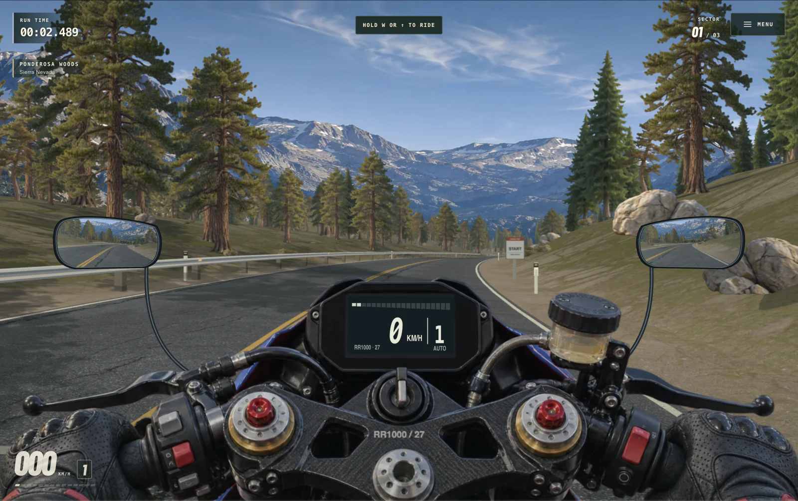
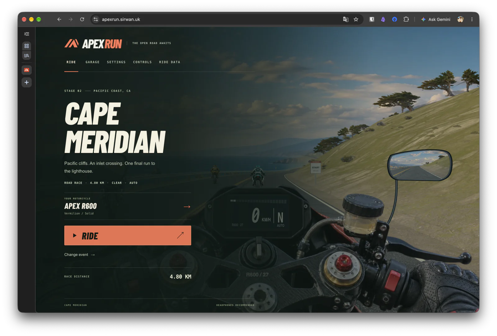
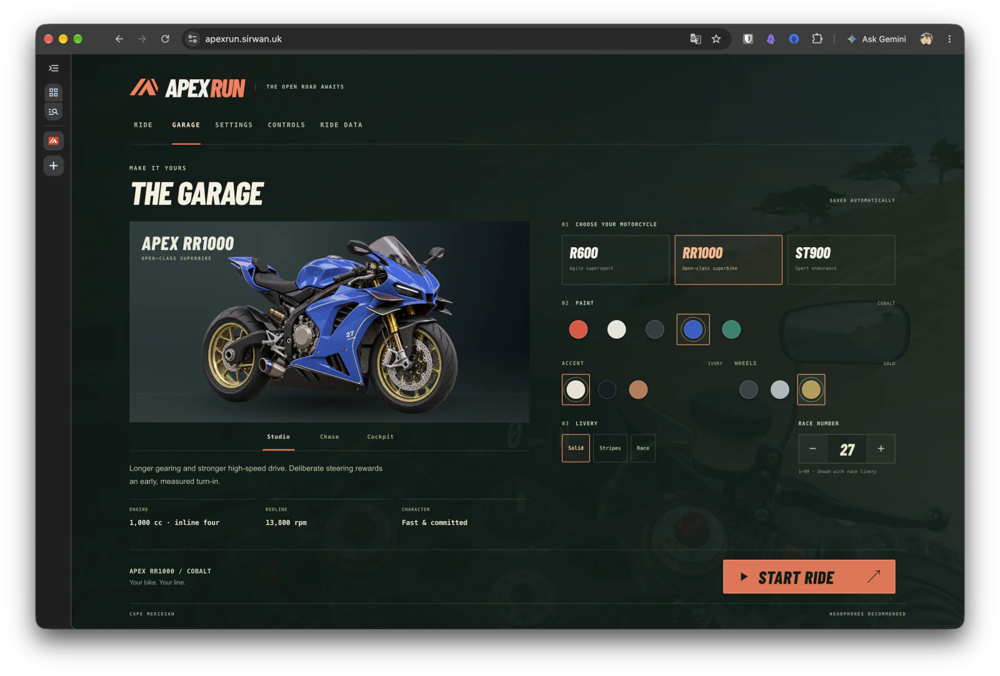

<h1 align="center">APEX RUN</h1>

<p align="center">
  <strong>The open road awaits.</strong><br>
  Motorcycle racing through mountain passes, coastal roads, and the capital.<br>
  Play in your browser, or explore the native Apple TV prototype.
</p>

<p align="center">
  <a href="https://apexrun.sirwan.uk"><strong>Play in your browser →</strong></a>
  &nbsp;·&nbsp; <a href="#quick-start">Quick start</a>
  &nbsp;·&nbsp; <a href="#controls">Controls</a>
  &nbsp;·&nbsp; <a href="#apple-tv">Apple TV</a>
</p>

[](https://apexrun.sirwan.uk)

<p align="center"><sub>Sierra Pass · Cockpit camera · The road ahead is yours.</sub></p>

## Find your line

Chase a personal best on Sierra Pass, or line up against three riders on Cape Meridian and A3 London.

| Course | Setting | Distance | Event |
| --- | --- | --- | --- |
| **Sierra Pass** | Sierra Nevada mountains | 4.00 km | Solo time trial |
| **Cape Meridian** | Pacific coast | 4.80 km | Road race |
| **A3 London** | A fictional, condensed closed course approaching London | 6.00 km | Road race |

- **Your motorcycle.** Choose the Apex R600, RR1000, or ST900, each with its own tuning. Customize paint, accents, wheels, livery, and race number.
- **Your conditions.** Ride in clear weather or rain, switch between cockpit and chase cameras, and choose automatic or manual gears.
- **Your next personal best.** Review speed traces, sector splits, top speed, and maximum lean. Ride data and best times stay on your device.
- **Your controls.** Use a keyboard, a standard game controller, or touch input.

## A look inside

<table>
  <tr>
    <td width="50%">
      <a href="docs/images/home.webp"></a>
    </td>
    <td width="50%">
      <a href="docs/images/garage.webp"></a>
    </td>
  </tr>
  <tr>
    <td><strong>Choose your ride</strong><br>Pick an event and head for the starting line.</td>
    <td><strong>Make it yours</strong><br>Build your look in the garage before heading out.</td>
  </tr>
</table>

## Quick start

You need **Node.js**, **Python 3**, and a modern web browser. The build and JavaScript tests use Node.js built-in modules; no npm packages are required.

```sh
git clone https://github.com/SirwanAfifi/apex-run.git
cd apex-run
node build.mjs
python3 -m http.server 8000 --bind 127.0.0.1 --directory dist
```

Open **[localhost:8000](http://127.0.0.1:8000)**, then select **Ride → choose a motorcycle → Start Ride**. If you already have the repository, run the last two commands from its root. Press `Ctrl+C` to stop the server.

After editing `src/`, run `node build.mjs` again and refresh the browser.

## Controls

| Action | Keyboard |
| --- | --- |
| Accelerate | `W` or `↑` |
| Brake | `S` or `↓` |
| Steer | `A` / `D` or `←` / `→` |
| Shift down / up in manual mode | `Q` / `E` |
| Change camera | `C` |
| Pause or resume | `P` or `Escape` |

<details>
<summary><strong>Game controller</strong></summary>

Use the left stick to steer, the right trigger to accelerate, and the left trigger to brake. In manual mode, use the left and right shoulder buttons to shift down and up.

</details>

<details>
<summary><strong>Touch screen</strong></summary>

Hold one finger on the game to accelerate and move it sideways to steer. Hold a second finger to brake; lift your fingers to coast. In manual mode, move the first finger quickly up or down to change gear.

</details>

Release the driving controls after a pause or crash recovery. Then apply them again.

## Apple TV

The native Apple TV prototype runs the shared race simulation through **JavaScriptCore** and renders the course with **SceneKit**. It requires **tvOS 17+** and Xcode on a Mac.

```sh
open native/tvos/ApexRunTV.xcodeproj
```

Select the **ApexRunTV** scheme and an Apple TV simulator, then run. For a physical Apple TV, set your development team in **Signing & Capabilities** and pair the device with Xcode.

The prototype currently supports **Cape Meridian · Apex R600 · Clear weather · Automatic gears · Chase camera**. Other browser features are not yet available, and browser and Apple TV saves do not sync.

See the [Apple TV guide](native/tvos/README.md) for controls, build commands, and known limits, or the [TestFlight notes](native/tvos/TESTFLIGHT.md) for recorded release results.

## Development

### Build and test

The build checks JavaScript syntax, combines the source files into `dist/game.js`, and updates file version values in `dist/index.html`.

> **Keep `dist/` in Git.** It also contains the authored HTML, CSS, and game assets. Do not delete it as a build cleanup step.

Run all JavaScript tests from the project root:

```sh
for test_file in tests/*.cjs; do
  node "$test_file" || exit 1
done
```

The eight test files cover collisions, courses, menus, mirrors, motorcycles, touch input logic, and the shared native simulation. They use simulated browser and native hosts; browser layout and physical touch or game controller input require separate testing.

### Project layout

| Path | Contents |
| --- | --- |
| `src/` | Shared simulation and browser code |
| `dist/` | Browser HTML, CSS, built JavaScript, and game assets |
| `tests/` | JavaScript test files |
| `native/tvos/` | Apple TV app, Xcode project, native tests, and release notes |
| `docs/images/` | Optimized WebP screenshots for this README |
| `build.mjs` | Browser build script |

<details>
<summary><strong>Regenerate the Xcode project</strong></summary>

The Xcode project is included in Git. If you change its file list or build settings, update `native/tvos/project.yml`, then use XcodeGen:

```sh
xcodegen generate --spec native/tvos/project.yml
```

Local Apple build files are stored in `native/tvos/build/`. Git ignores this directory and Xcode user settings.

</details>

---

Typography: **Barlow Condensed** — [font license](dist/assets/OFL.txt).
