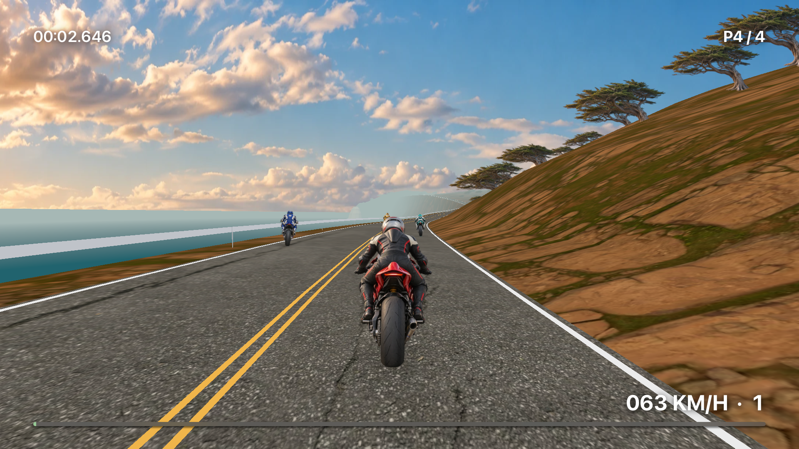

# Apex Run for Apple TV

Apex Run is a native tvOS racing prototype. It includes Cape Meridian, the Apex
R600, clear weather, automatic gears, and a chase camera.

The app runs the shared JavaScript simulation in JavaScriptCore. SceneKit and
UIKit display the game. GameController reads input. AVAudioEngine produces sound.
The app runs locally. It does not need a browser, server, or network connection.

## Open and run

The project requires Xcode and targets tvOS 17 or later.

1. Open `native/tvos/ApexRunTV.xcodeproj` in Xcode.
2. Select the `ApexRunTV` scheme.
3. Select an Apple TV simulator.
4. Select **Run**.

To use a physical Apple TV:

1. Select your development team under **Signing & Capabilities**.
2. Pair the Apple TV with Xcode.
3. Select the Apple TV as the destination.
4. Select **Run**.

The repository includes the Xcode project. XcodeGen is only necessary to
regenerate it. If source files or build settings change, run this command from
the repository root:

```sh
xcodegen generate --spec native/tvos/project.yml
```

The build reads the shared files in `src/` and `dist/assets` directly. You do not
need to copy these files. To build the browser version, run:

```sh
node build.mjs
```

## Controls

| Device | Steer | Accelerate | Brake | Pause / resume |
| --- | --- | --- | --- | --- |
| Xbox / PlayStation / extended controller | Left stick | Right trigger | Left trigger | Menu / native menu action |
| Siri Remote | Left / right | Hold click | Down | Play/Pause |
| Keyboard | A / D or left / right | Hold Enter / Space, W / up | S / down | P / Escape to pause, Enter / Space to resume |

Use the tvOS focus system to select Ride, Resume, Restart, or Sound. Release all
driving controls after a start, pause, controller disconnection, or crash
recovery. Then apply the accelerator again.

Use Xcode's Apple TV Remote panel to send remote input to the simulator.
Physical game controllers still require tests on an Apple TV.

## Shared code and assets

The native app uses these parts of the browser game:

- `engine.js`: physics, transmission, grip, suspension, and timing.
- `race.js`: opponents and standings.
- `collision.js`: crashes and recovery.
- The motorcycle catalogue and tuning data.
- `world-model.js`: the numeric world model for the browser and tvOS. Its formulas
  came from `scenery.js` without changes.
- Coast geometry helpers, landmark faces, and foliage positions.
- WebP rider and landscape images, textures, and the Barlow Condensed font.
- Engine firing intervals and Fourier wave construction for sound. Native audio
  approximates the browser mix. It does not use the same Web Audio graph.

`Runtime/host.js` supplies the clock, storage, and control of each simulation
step. `GameRuntime.swift` loads the shared scripts. It sends reset events to the
native input code.

The app stores best runs in tvOS UserDefaults. It uses the browser game's record
format. It does not transfer or synchronize browser saves.

## Prototype limits

The native renderer builds the shared course with SceneKit meshes and billboard
images. It does not run the browser's WebGL shader or Canvas drawing code.

The tvOS interface does not include these features:

- Rain.
- The cockpit and mirrors.
- Garage customization.
- London or Sierra course selection.
- Telemetry screens.
- All browser graphics and materials.

Some generated posts, walls, ground details, and non-tree plants are also absent.
SceneKit is the prototype renderer. Evaluate Metal before planning full graphics
support.

Frame rate, memory use, audio output, and physical controller operation still
require tests on an Apple TV. Simulator results do not establish device
performance.

## TestFlight release

The release settings use these values:

| Setting | Value |
| --- | --- |
| Developer team | SIRWAN AFIFI (`MD4N52M5TD`) |
| Bundle ID | `com.sirwanafifi.apexrun` |
| Version | `0.1.0` |
| Version and build number source | `project.yml` |

The project includes layered tvOS icons and Top Shelf images. It also includes a
UserDefaults privacy declaration and the non-exempt-encryption declaration.

TestFlight distribution does not require a registered Apple TV. Device tests and
direct installation from Xcode require an Apple TV.

Before an upload:

1. Sign in to the developer account in Xcode.
2. Make sure the team's agreements are current.
3. Create the tvOS app record in App Store Connect.
4. Make sure the app record and project use the same bundle ID.

See [TESTFLIGHT.md](TESTFLIGHT.md) for the beta description, test instructions,
and detailed release history.

### Recorded release results

These results were recorded on 5 November 2026. They are not a live check of
TestFlight status.

| Build | Upload time (UTC) | Recorded result |
| --- | --- | --- |
| `0.1.0 (1)` | 17:16:45 | Apple validation and upload passed. The installed app opened and immediately closed on a physical Apple TV. |
| `0.1.0 (2)` | 20:32:56 | Upload passed. The app also failed to open on an Apple TV A2169 with tvOS 27.2. |
| `0.1.0 (3)` | 21:14:03 | Upload passed. Apple reported that the package was processing. TestFlight readiness and installation were not verified. |

Build 2 added held Enter/Return and Space input for acceleration. It also added
separate key release, neutral input before driving resumes, and cancelled-key
handling. All 12 Release unit and UI tests passed in the simulator. These changes
did not correct the device launch failure.

A Release build reproduced a startup `SIGTRAP` on tvOS 27.0. UIKit required the
scene lifecycle. The physical Apple TV's build 2 crash report confirmed the same
cause.

Build 3 adds a scene manifest and creates the window in `SceneDelegate`. It also
suspends the race when the scene becomes inactive. All 13 Release unit and UI
tests passed on tvOS 27.0. These tests included cold launch and return from the
background.

A development-signed Release build 3 then ran on a physical Apple TV 4K, second
generation, model A2169. The device used tvOS 27.2 (24K122). The app displayed the
race menu and stayed open for more than one minute. This result verifies the
startup fix on that device. Full gameplay, physical input, and build 3
installation through TestFlight remain unverified.

The tvOS 27.2 simulator download stopped when the physical device became
available. The local browser-viewer guard and AXe adapter under `/tmp` are
simulator tools. The app does not include them.

Release archives, IPA files, `release.json` files, and upload logs are stored
locally in these ignored directories:

- `native/tvos/build/releases/0.1.0-2/`
- `native/tvos/build/releases/0.1.0-3/`

See the [device launch screenshot](evidence/apple-tv-build3-launch.png) and
[startup diagnosis](evidence/tvos27-launch-failure.md). Use the
[TestFlight build page](https://appstoreconnect.apple.com/apps/6831247985/testflight)
to check current processing status and tester access.

### Archive with development signing available

Use this command when Xcode can create a development profile. For example, the
team can have a registered Apple TV. Run the command from the repository root:

```sh
xcodebuild archive \
  -project native/tvos/ApexRunTV.xcodeproj -scheme ApexRunTV \
  -configuration Release -destination 'generic/platform=tvOS' \
  -archivePath /tmp/apex-run-testflight/ApexRunTV.xcarchive \
  -allowProvisioningUpdates
```

### Archive without a registered Apple TV

Automatic development signing can fail if the team has no registered tvOS
device. In this case, create an unsigned archive. Use App Store Connect export
for distribution signing:

```sh
xcodebuild archive \
  -project native/tvos/ApexRunTV.xcodeproj -scheme ApexRunTV \
  -configuration Release -destination 'generic/platform=tvOS' \
  -archivePath /tmp/apex-run-testflight/ApexRunTV-unsigned.xcarchive \
  CODE_SIGNING_ALLOWED=NO CODE_SIGNING_REQUIRED=NO
```

You cannot install this unsigned archive directly. The following local export
passed on 5 November 2026. Xcode used automatic cloud signing to produce a signed
App Store IPA. That export required no registered Apple TV or local Apple
Distribution identity. The account must have permission to use distribution
signing.

```sh
mkdir -p /tmp/apex-run-testflight
cp native/tvos/ExportOptions.plist /tmp/apex-run-testflight/ExportOptions-local.plist
plutil -replace destination -string export /tmp/apex-run-testflight/ExportOptions-local.plist
xcodebuild -exportArchive \
  -archivePath /tmp/apex-run-testflight/ApexRunTV-unsigned.xcarchive \
  -exportOptionsPlist /tmp/apex-run-testflight/ExportOptions-local.plist \
  -exportPath /tmp/apex-run-testflight/distribution \
  -allowProvisioningUpdates
```

The signed file is `/tmp/apex-run-testflight/distribution/ApexRunTV.ipa`.
This export does not upload a build or create an App Store Connect app record.
Move required release files outside `/tmp` before temporary files are removed.

### Upload

Create the matching app record before you upload. The following command uses the
unsigned archive. For a development-signed archive, change the archive path to
`ApexRunTV.xcarchive`.

This command uploads the build to Apple:

```sh
xcodebuild -exportArchive \
  -archivePath /tmp/apex-run-testflight/ApexRunTV-unsigned.xcarchive \
  -exportOptionsPlist native/tvos/ExportOptions.plist \
  -exportPath /tmp/apex-run-testflight/upload \
  -allowProvisioningUpdates
```

`ExportOptions.plist` selects App Store Connect distribution, automatic signing,
and build-number management. Check the processed version and build number in
App Store Connect.

A successful export or upload does not confirm that Apple has finished
processing the build. An upload does not invite external testers or publish the
app to the store. External beta tests require TestFlight review and tester
setup.

## Verification

Run the shared browser and native JavaScript checks from the repository root:

```sh
for test in tests/*.cjs; do node "$test" || exit 1; done
```

Run the `ApexRunTV` scheme's tests in Xcode with Command-U. Alternatively, run:

```sh
xcodebuild test \
  -project native/tvos/ApexRunTV.xcodeproj \
  -scheme ApexRunTV \
  -destination 'platform=tvOS Simulator,name=Apple TV 4K (3rd generation) (at 1080p),OS=27.0' \
  -parallel-testing-enabled NO
```

Select an installed simulator runtime if tvOS 27.0 is unavailable.

The tests check these functions:

- JavaScriptCore script loading.
- Acceleration, pause, resume, and restart.
- Reset events after a crash.
- Course geometry and WebP decoding.
- Remote input in menus and during a race.
- Cold launch and return from the background.

The JavaScript comparison test supplies the same input and time steps to both
hosts. It then compares their physics and race states.

On 5 November 2026, all 13 Release native tests passed on the tvOS 27.0 simulator.
All eight JavaScript suites had also passed. Earlier tvOS 26.1 tests used remote
input to start, pause, resume, restart, and accelerate with a held click. The
image below came from that test.


